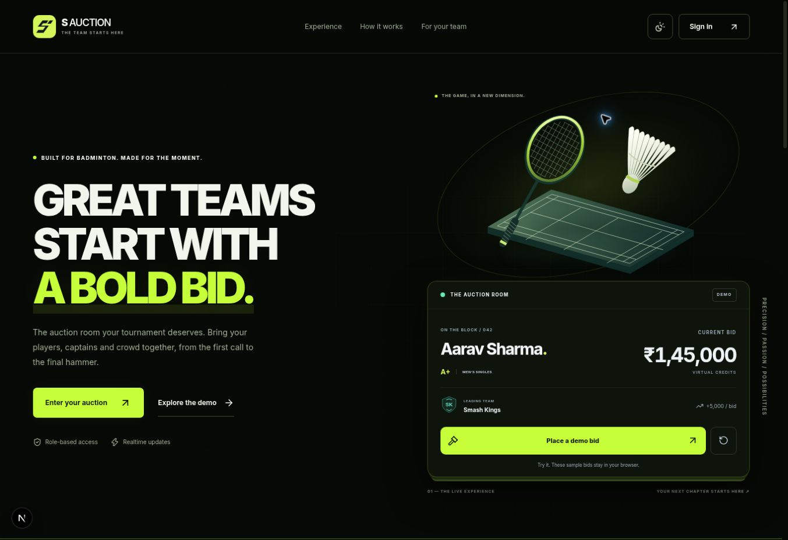
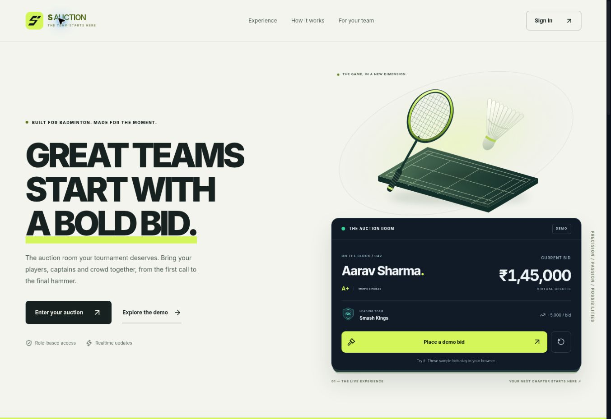

# S Auction redesign

The auction system pairs a navy, lime and off-white light theme with a black and neon-lime dark theme. It retains the existing Supabase backend, role permissions and virtual-credit auction rules.

## Experience

- Custom vector S monogram, wordmark, favicons, app icons and social preview artwork. Regenerate the packaged artwork with `npm run brand:generate`.
- Redesigned homepage, sign-in, navigation, dashboard, team identities and player cards across the captain, auctioneer, spectator and projector screens.
- The dashboard reads the latest auction and shows actual roster counts, queued players, virtual spend, team purses and the latest allotment.
- `/demo` runs entirely in browser memory with fictional sample data. It makes no auction or database changes.
- Mobile layouts, visible keyboard focus, a native dialog navigation drawer, accessible form labels, reduced-motion support and broken-image fallbacks.
- Inline custom bids, purse-aware bid controls, duplicate-submit guards and recoverable connection errors. Existing server/database validation remains authoritative.
- Self-hosted Inter fonts with their SIL Open Font License in `public/fonts/OFL.txt`.

## Light and black-neon themes

- Light, Dark and System choices are available from the homepage, demo, sign-in screen and workspace header. The preference survives reloads, follows device changes in System mode and synchronizes across open tabs. Storage restrictions fall back to an in-memory preference.
- A fixed script applies the stored or system preference before the first paint. Shared semantic colors cover surfaces, forms, text, status messages, player panels and navigation. Light-mode text uses darker accent colors while primary buttons retain bright lime surfaces.
- The dark homepage adds neon typography, a subtle court grid, illuminated dimensional icons, restrained button glows and a single entrance sweep along the sample auction card. Theme changes have a brief color transition and icon rotation; they preserve the existing React child tree and current bids.
- The sticky header shows reading progress and the active section. Mobile navigation uses a compact animated disclosure with Escape, outside-click and focus-leave dismissal. Theme controls and navigation retain visible keyboard focus and reduced-motion overrides.

Desktop dark-theme preview with the static WebGL fallback:



## Navigation and interactive auction experience

- Searchable quick navigation opens from the workspace header or Ctrl/Cmd+K. Results come from the existing navigation for the signed-in role. The native modal supports arrow keys, Enter, Escape, focus restoration, backdrop dismissal and scroll containment. It navigates only; it does not perform auction actions.
- The homepage now has a keyboard-accessible role showcase with dimensional sample workspace cards. Links open the appropriate Captain, Auctioneer or Spectator demo perspective; sample figures are explicitly labelled.
- The demo adds a room activity timeline, bidding stages, pause/resume controls, a confirmed-sale panel, the existing dismissible sale celebration and animated purse meters. The activity list retains the latest eight actions. The opening sample bid now equals the base price, subsequent bids use the increment, and purses change only after a sale.
- A pure reducer guards repeated bids, invalid sales, paused/sold states and the sample purse limit. Four regression tests cover these transitions and reset behavior. Demo actions remain entirely in browser memory; no production data or backend rules are modified.
- Captains also receive a visual meter for their existing available-to-bid amount after captain reserves. Its budget reference accommodates purse top-ups; exact currency values still render immediately. New animation is finite and covered by the shared reduced-motion override.

## Motion and interaction polish

- Coordinated hero and illustration entrances, one-time scroll reveals, animated navigation underlines and restrained button/arrow feedback. Scroll content is visible without JavaScript; already-visible content is not hidden after hydration.
- Short workspace route transitions preserve the child tree and do not replay when realtime auction data updates. Dashboard cards enter in a brief sequence; player changes and incoming bids have distinct visual cues.
- Bid and purse values render their exact new value immediately, with a brief highlight. Monetary figures never count through intermediate amounts.
- The demo has a sliding perspective selector with arrow-key/Home/End navigation, an associated tab panel, clear action feedback, sale confirmation and a virtual purse limit.
- The native mobile dialog animates in and out on browsers supporting discrete transitions, with an immediate-close fallback. Focus trapping, Escape, focus restoration and existing body overflow are preserved.
- Sales use a dismissible, non-modal celebration with finite confetti and Escape dismissal. The rest of the workspace remains interactive.
- CSS and Web Animations honor reduced motion, including preference changes during a running animation. Focus cancels decorative reveals.

## 3D design

- The public homepage features a procedural Three.js badminton racket and feathered shuttle above a raised miniature court, with soft shadows, slow floating motion and restrained mouse parallax. Models and materials are generated locally; there are no external model or texture downloads.
- The renderer is imported only when the scene enters the viewport. Rendering is capped at 30 frames per second and 1.5 device-pixel ratio, pauses off-screen and in hidden tabs, and releases its GPU resources on unmount. A visible Play/Pause button gives users control; reduced-motion preferences produce a still frame and disable parallax.
- A server-rendered SVG illustration remains visible before initialization, with JavaScript disabled, or if WebGL initialization/context fails. The canvas reserves its height and never intercepts touch gestures.
- The sample auction card has a compact layout with layered shadows. It retains local-only demo bidding, reset, exact amounts and live announcements. Feature and role icons have dimensional surfaces with gentle hover responses, and the closing call to action and sign-in page use a lightweight CSS sculpture of the S monogram.
- Three.js is isolated to the public hero's lazy module. Authentication and auction screens do not load the WebGL renderer. The existing authorization and bidding rules are unchanged.
- Focusing the homepage permanently completes its hero entrances, so moving focus away from a bid or reset button cannot replay the whole card's entrance.

Desktop browser review with WebGL disabled (the SVG fallback is shown):



## Security changes

- Block cross-origin browser writes at the API boundary; routes retain their own authentication, authorization or webhook signature checks.
- Restrict post-login destinations to application paths and avoid putting provider error messages into redirect URLs.
- Bound multipart/webhook bodies while reading the stream, including requests without a Content-Length header.
- Require a controller or the team's currently authorized captain role for logo uploads. Verify raster signatures, decode only still JPEG/PNG/WebP images, cap size/pixels and re-encode to a metadata-free WebP with a unique storage path. Remove a new upload if saving its database reference fails.
- Remove internal captain account IDs from unauthenticated spectator snapshots.
- Add response headers for framing, MIME sniffing, referrers and browser permissions, plus production HSTS and private API caching. The CSP is a baseline for objects, base URLs and framing; it is not a comprehensive script policy.
- Update Next.js and its ESLint configuration to 16.4.3, retaining sharp 0.35.5 and the patched transitive source-map dependency. The framework update addresses the dependency audit findings for [image optimization](https://github.com/vercel/next.js/security/advisories/GHSA-2464-fhr4-w9xw), [Server Actions](https://github.com/vercel/next.js/security/advisories/GHSA-p3m5-59mp-jv5r) and [typed arrays in cached functions](https://github.com/vercel/next.js/security/advisories/GHSA-673q-mjm6-r5xr). These advisories were flagged during the motion update's CI run on 23 October 2026.
- Remove the unused direct Zod dependency from the production dependency graph after the audit flagged [GHSA-mrhx-c7xc-m3w5](https://github.com/advisories/GHSA-mrhx-c7xc-m3w5). Application code has no Zod imports or schemas. Zod remains a development-only transitive dependency of the lint tooling; this is a runtime dependency cleanup, not a claim that all development dependencies are vulnerability-free.

## Verification and release

Run with Node.js 22:

```sh
npm ci
npm run typecheck
npm test
npm audit --omit=dev --audit-level=high
npm run build
```

The twelve Node tests cover the existing CSV/signature/identifier helpers, origin, redirect, streamed-body and image validation protections, plus the four demo state-transition regressions. The quality workflow also builds the application.

For the navigation/interactive-demo update, local TypeScript, production build, all twelve tests and the production dependency audit passed. Local browser review was unavailable: the managed preview reported a running URL but stopped before the browser could connect. Verify the role tabs/deep links, quick-navigation focus and keyboard behavior, demo bid → pause → resume → sale → reset flow, and both palettes on desktop and phone in the hosted preview before production rollout. Authenticated navigation and the captain purse meter still need a staging account review.

The theme update passed the production build, TypeScript check, eight Node tests and production dependency audit (zero findings). Desktop browser checks covered both palettes on the homepage, demo and sign-in screen, persistence on reload/navigation, cross-tab synchronization, unchanged sample bids when switching themes, keyboard dismissal/focus restoration, active-section navigation and page-width overflow. The supplied browser had WebGL disabled and did not expose a mobile viewport or OS preference emulator, so GPU rendering, physical mobile layouts and runtime OS/reduced-motion changes still need device review. The repository has no ESLint flat configuration, so `npm run lint` is not a passing validation step.

For the 3D hero, check Play/Pause, changing reduced-motion preferences, scrolling off-screen, switching tabs and navigating away on a WebGL-enabled desktop and phone. Also check the static illustration with WebGL disabled. A successful build verifies the code and bundle, but does not verify GPU rendering or device frame rates.

Public product pages and the demo can be previewed without database credentials. Authenticated functionality requires the existing Supabase environment variables and migrations. No database migrations or production records are changed by this update.

Before using a real auction, complete the role, concurrent bidding, viewer-token, upload/storage and state-transition checks in `AUCTION_RELEASE_TEST_PLAN.md` and `SECURITY_RELEASE_NOTES.md` against an isolated staging database. Passing unit tests and a production build does not establish that the live database has the required migrations or policies.
